<div align="center">

# ✍️ 手写体生成器 & 字体制作器
### Handwriting Generator (汉字 · English · 数字) & Interactive Font Maker

**零后端依赖 · 纯浏览器离线运行 · 汉字 / 英语字母 / 数字全支持 · 表格 / 作文纸 / 草稿纸一键生成逼真手写 PDF**

[-1668dc?style=flat-square)](#)
[](#)
[](#)
[](./docs/architecture.html)
[](./LICENSE)

<p align="center">
  <a href="#-功能亮点">功能亮点</a> •
  <a href="#-效果预览">效果预览</a> •
  <a href="#-系统架构-archify">系统架构</a> •
  <a href="#-三步拍照制作专属字库">字体制作器</a> •
  <a href="#-快速开始">快速开始</a> •
  <a href="#-目录结构">目录结构</a>
</p>

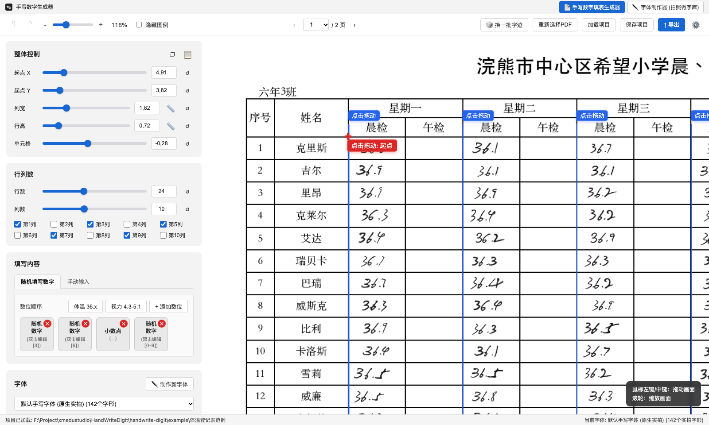

</div>

---

## 📖 项目简介

**手写数字生成器（Handwrite Digit Generator）** 是一款专为表格填报、实验记录、日常登记表（如体温登记表、视力自测表、巡检记录单等）打造的 **纯前端手写数字仿真生成与自制字库工具**。

不同于传统机械套用单一 TTF 字体的方案，本项目采用 **「同类多变体实拍 PNG 字形随机采样 + 四大维度仿射形变引擎」**：同一个数字（如 `3`、`6`、`5`、`0`）在字库中拥有 **10～15 种真实手写变体**，每次落笔自动结合随机字形、字距微调、轻度墨色浓淡、笔压加粗与基线微抖动，使整张表格呈现出自然、工整且绝不呆板雷同的真人手写质感。

---

## 🆕 汉字 & 英语字母手写 + 8 个双页 PDF 示例

- **全字库汉字 / 英语字母 / 符号**：任意汉字、大小写英文字母、标点和数学符号（`∫ √ π ≈ ℃ %`）都能写成手写体。每个字符会在离屏 Canvas 上生成 **5 种带笔压和倾斜微扰的手写变体**并缓存，数字默认仍使用实拍字形。
- **6 种内置手写风格**：`实拍数字 + 翩翩手写中英`（推荐）、`清秀学生手札体`、`潇洒行楷连笔体`、`锋芒钢笔凌慧体`、`随性娃娃手写体`、`工整考卷正楷体`。
- **6 种墨水颜色**：碳素黑、柔和黑、蓝黑钢笔、蓝色圆珠笔、2B 铅笔灰、教师批阅红。实拍数字字形也会跟着换色。
- **三种填写模式**：
  - `随机填写`：新增 **手写汉字 / 英语字母 / 自定义候选池** 槽位类型，可以一键套用「汉字状态」「英文评级」预设。
  - `手动表格`：可以任意混排中英文和数字。内置成绩评定、实验室巡检、中英双语词汇等仿真数据，文字超出格宽时会自动缩小，不会溢出到相邻列。
  - `文章/稿纸`：**方格作文纸模式**一字一格，支持段首空两格，句末标点不会出现在行首；**横线/草稿纸模式**中英文自然换行，英文单词不会从中间断开。

| 示例 | 类型 | 内容 |
| :--- | :--- | :--- |
| 示例1 | 晨午检体温登记表（横版 · 2页） | 数字 `36.1`–`36.9` |
| 示例2 | 学生视力自测登记表（竖版 · 2页） | 数字 `4.3`–`5.1` |
| 示例3 | 实验考勤与成绩评定表（横版 · 2页） | 汉字评语 + 英文组别 / 等级 + 分数 + 签名 |
| 示例4 | 实验室温湿度巡检记录表（竖版 · 2页） | `LAB-A01` 编号 + `23.5℃` / `48.2%` + 中文状态 |
| 示例5 | 中文方格作文纸 20×20（竖版 · 2页） | 400 字 / 页，中文散文逐格手写 |
| 示例6 | 英语横线作文纸（竖版 · 2页） | 英文作文流式手写 |
| 示例7 | 空白演算草稿纸（竖版 · 2页） | 数学 / 物理公式 + 中英推导 |
| 示例8 | 中英双语读书笔记纸（竖版 · 2页） | 英文单词 + 中文释义 + 英文例句 |

| 首页 8 个示例 | 示例5：中文方格作文纸 |
| :---: | :---: |
| 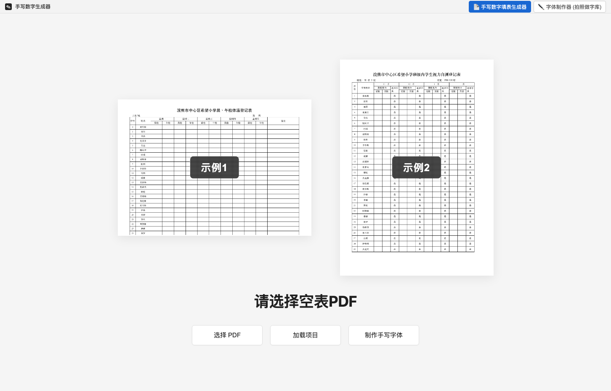 | 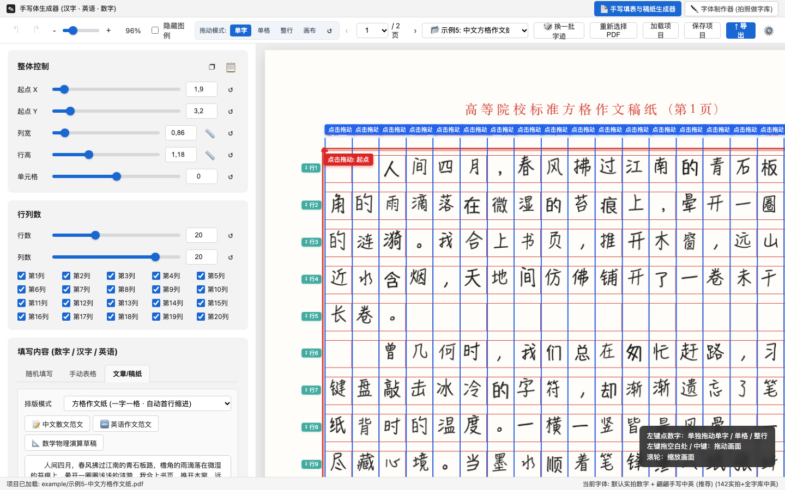 |
| **示例6：英语横线作文纸（蓝黑墨水）** | **示例7：空白演算草稿纸** |
| 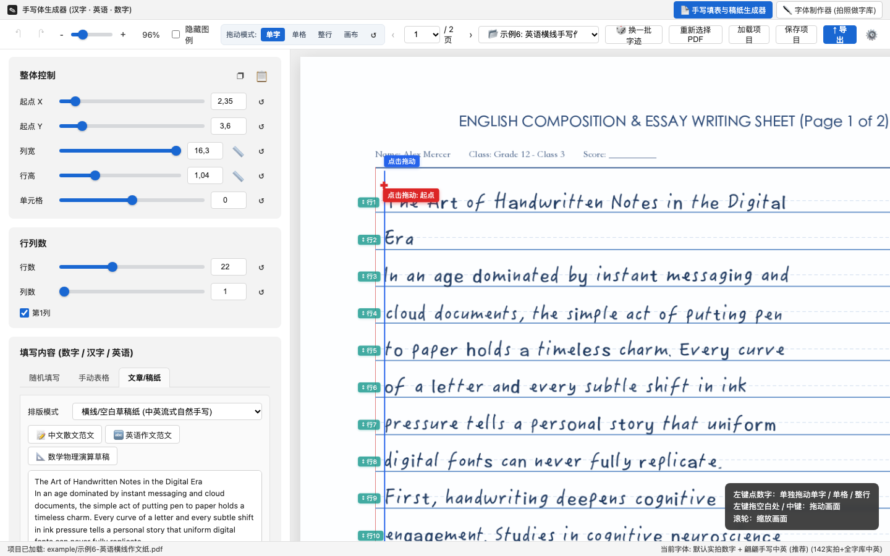 | 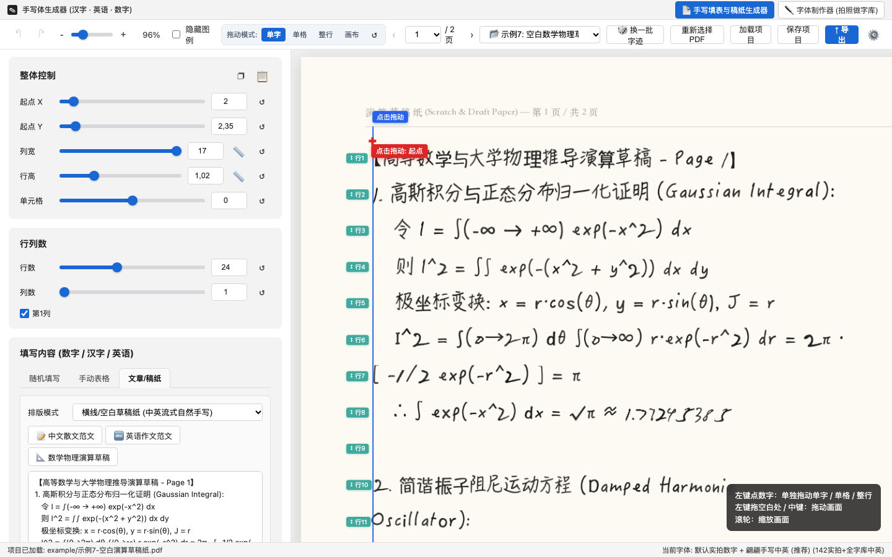 |
| **示例3：中英数混排成绩评定表** | **示例8：中英双语读书笔记** |
| 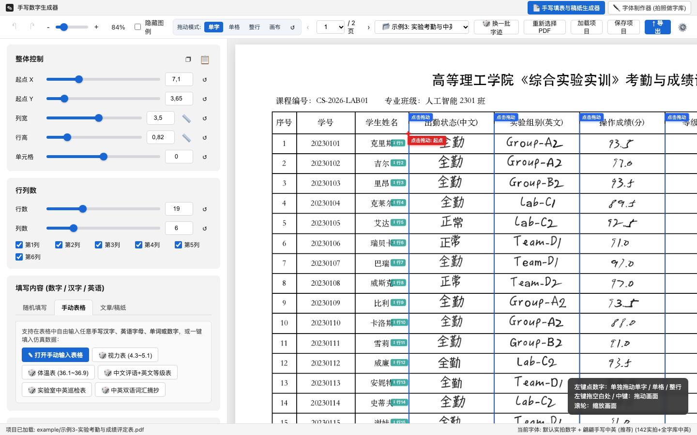 | 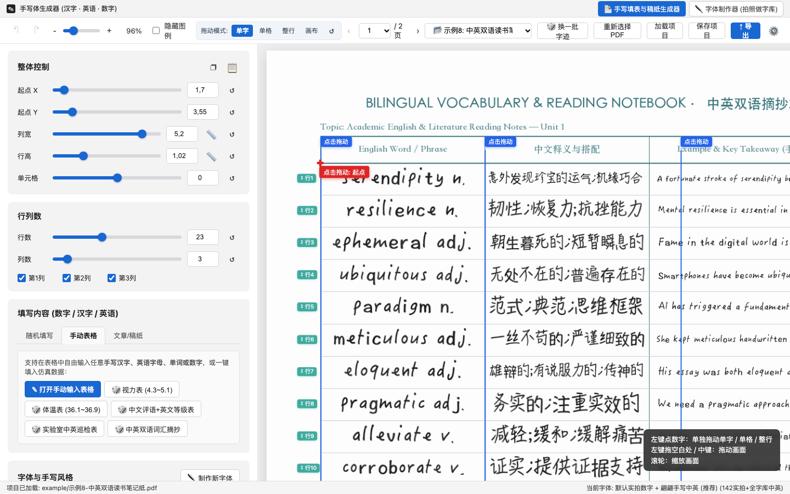 |

> 汉字和英文的手写效果依赖系统已有的手写类字体，例如 macOS 自带的 *翩翩体 HanziPen SC、手札体 Hannotate SC、行楷 Xingkai SC、凌慧体 LingWai SC、娃娃体 Wawati SC、楷体 Kaiti SC、Bradley Hand、Noteworthy*。缺少某个字体时会按顺序回退到下一个可用字体。

---

## ✨ 功能亮点

<table>
  <tr>
    <td width="50%" valign="top">
      <h3>📄 1. 手写数字填表生成器</h3>
      <ul>
        <li><b>多页空表 PDF 自由导入</b>：基于 <code>PDF.js</code> 152 DPI 厘米级坐标解析，支持任意横版/竖版多页 PDF 空表。</li>
        <li><b>所见即所得多粒度拖拽微调</b>：支持<b>「单字 / 单格 / 整行 / 单列 / 整体起点」</b>五种独立拖拽微调——可直接在画布上按住任意单个数字、单个单元格、某一行（或左侧橙色 <code>↕ 行N</code> 手柄）、某一列（顶部蓝色 <code>点击拖动</code> 线）自由调整位置，互不干扰，并支持一键重置微调与撤销/重做。</li>
        <li><b>双模式数据填充</b>：
          <ul>
            <li><b>随机填写数字</b>：可视化编辑<b>「数位顺序」</b>槽位（任意组合固定数字、随机数字池 <code>[0-9]</code> 与小数点 <code>.</code>）。</li>
            <li><b>手动电子表格</b>：弹窗式全表编辑器，未勾选显示的列自动以浅黄色高亮并标注 <code>(未显示)</code>。</li>
          </ul>
        </li>
        <li><b>四大维度手写仿真控制</b>：独立双滑块区间控制<b>单元格随机</b>、<b>单字位置随机</b>、<b>单字形变随机</b>与<b>小数点随机</b>，支持单模块 <code>🎲</code> 摇号与全局<b>「🎲 换一批字迹」</b>。</li>
        <li><b>多页高清 PDF 导出</b>：支持多份批量合成（每次导出自动更新随机字迹分布）、实时进度条预览与直接调用打印。</li>
      </ul>
    </td>
    <td width="50%" valign="top">
      <h3>✒️ 2. 三步式拍照字体制作器</h3>
      <ul>
        <li><b>开箱即用原生字库</b>：内置 <b>142 个</b>经过精细去底与基线校准的实拍手写字形（涵盖 <code>1, 2, 3, 4, 5, 6, 7, 8, 9, 0, .</code>）。</li>
        <li><b>第一步：智能容差抠图</b>：在白纸上书写 11 行数字拍照上传，拖动<b>「容差」</b>滑块即可实时剥离纸张阴影，在透明棋盘格上预览纯净笔画。</li>
        <li><b>第二步：AI 连通域自动框字</b>：基于形态学膨胀与广度优先连通域（BFS）自动框选全部手写数字，支持拖拽调位、四角缩放、空白处补框与右键删除字框。</li>
        <li><b>第三步：红框批量标注与导出</b>：提供 11 色分类标签栏，支持<b>拉取红色虚线框整行批量标注</b>或<b>「⚡ 一键按行标注」</b>，一键导出并立即在主程序下拉框中切换使用。</li>
      </ul>
    </td>
  </tr>
</table>

---

## 🖼️ 效果预览

### 1. 内置双范例工程开箱体验
启动后默认提供 **示例1（A4 横版双页《晨、午检体温登记表》）** 与 **示例2（A4 竖版《学生视力自测登记表》）**，点击即可一键加载体验：

| 首页范例选择 | 手动输入电子表格模式（自动高亮未显示列） |
| :---: | :---: |
|  | 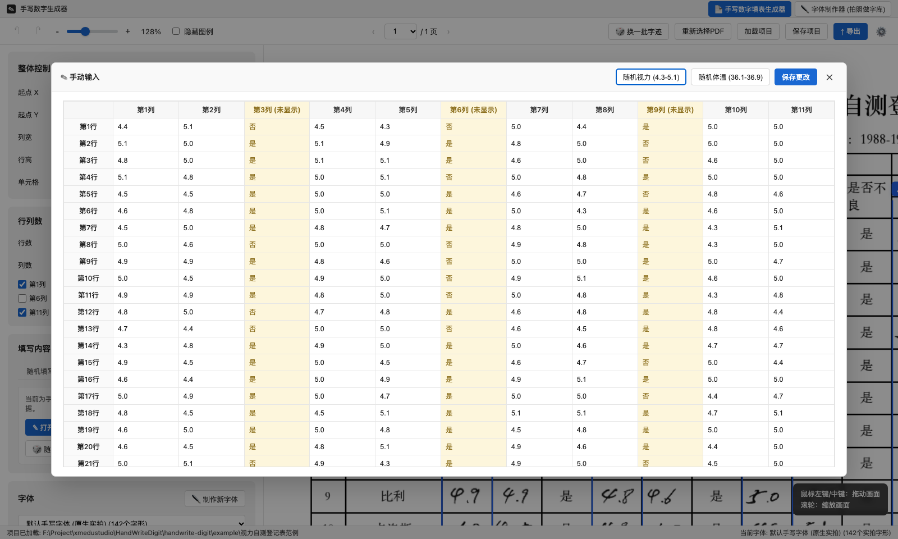 |

### 2. 体温表（`36.1`–`36.9`）与视力表（`4.3`–`5.1`）实拍字形合成效果

| 示例 1：晨、午检体温登记表（数位槽随机生成） | 示例 2：班级内学生视力自测登记表（跳过「是否不良」列） |
| :---: | :---: |
|  | 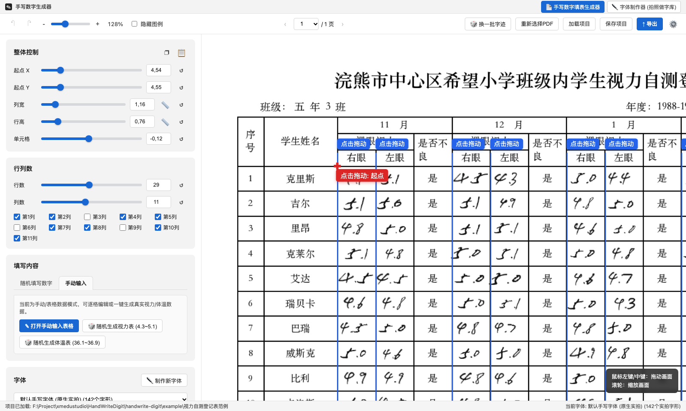 |

---

## 🏗️ 系统架构 (Archify)

以下系统架构图由 **Archify**（`showcase` 质量配置，通过全部 9 项几何与可读性校验）生成，支持根据 GitHub 浅色 / 深色主题自动切换；你也可以打开仓库内的交互式架构视图 [`docs/architecture.html`](./docs/architecture.html) 进行缩放、路径追踪与分步演示：

<div align="center">
  <picture>
    <source media="(prefers-color-scheme: dark)" srcset="./docs/images/architecture-dark.png">
    <source media="(prefers-color-scheme: light)" srcset="./docs/images/architecture-light.png">
    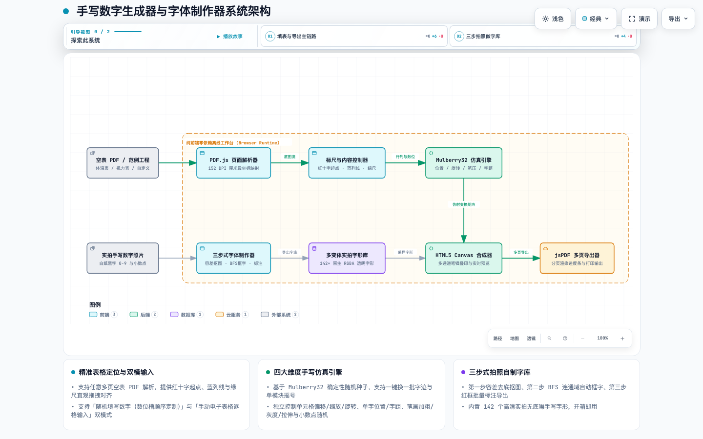
  </picture>
</div>

---

## ✒️ 三步拍照制作专属字库（支持汉字 · 英语字母 · 数字 + 个人笔迹特征迁移）

点击顶部导航栏的 **「✒️ 字体制作器 (拍照做字库)」** 或左侧字体卡片的 **「制作新字体」**，支持 **🔢 数字字库 (`0-9, .`)**、**🔤 英语字母字库 (`A-Z, a-z`)** 与 **🀄 汉字/自定义字表字库** 三大模式：

| 汉字/英语/数字自动偏旁合并与逐格标注 | 数字多变体批量标注与导出 |
| :---: | :---: |
| 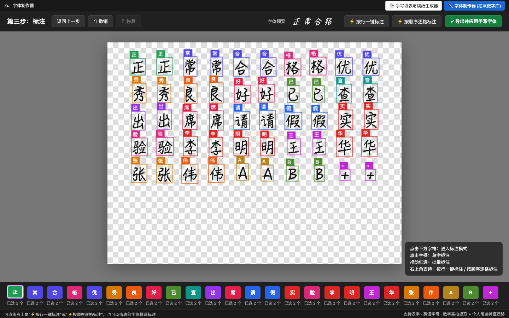 | 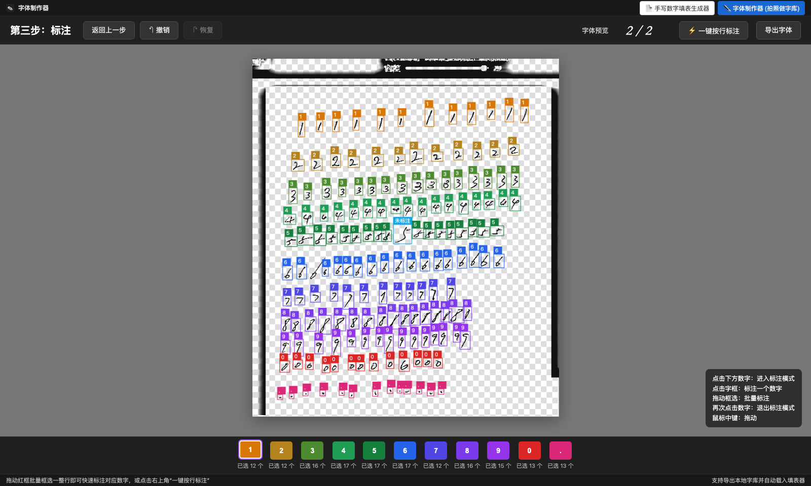 |

1. **选择模式或提取文档字表**：
   * 支持一键切换 **数字 / 英语字母 / 汉字自定义字表**，或点击 **「📥 提取当前文档字表」** 自动扫描当前表格/作文中用到的不重复汉字与字母。
   * 支持点击 **「🖨️ 下载书写字帖PDF」** 导出带淡灰描红参考字的 A4 方格采集表，打印或用 iPad 手写后拍照上传，也可直接点击 **「✨ 使用当前模式示例手写照片体验」**。
2. **第一步（自适应抠图）**：拖动顶部 **「容差」** 滑块（`5`–`75`），通过积分图局部背景估计算法滤除纸张阴影，保留干净的手写笔画。
3. **第二步（AI 框字 + 智能偏旁合并）**：自动运行连通域检测，并内置 **汉字偏旁/点画邻近聚合算法**（自动将左右结构如 `格/请/明`、上下结构如 `常/查` 及带点字母 `i, j` 合并为完整字框），也支持手动拖拽、缩放或点击 **「🔗 智能合并偏旁/部件」**。
4. **第三步（一键标注 + 个人笔迹特征迁移）**：支持 **「⚡ 按行一键标注」** 与 **「⚡ 按顺序逐格标注」**。导出字体时：
   * **已拍照录制的汉字 / 英语 / 数字**：100% 直接调用照片抠出的**真实手写原图切片**；
   * **未拍摄的生僻汉字**：自动通过二阶中心矩（Central Moments $\mu_{11}/\mu_{02}$）提取您照片中的**字身胖瘦比例、书写倾斜角与笔画浓淡粗细特征（Style Profile）**，自动迁移拟合至全字库！

---

## 🎛️ 四大维度手写仿真引擎参数说明

所有随机变换均基于确定性伪随机数生成器（`Mulberry32 PRNG`），既保证拖动标尺时字迹稳定不闪烁，又能通过 **「🎲 换一批字迹」** 一键切换全新手写排布：

| 控制模块 | 核心参数 | 仿真作用说明 |
| :--- | :--- | :--- |
| **整体控制** | `起点 X / Y`、`列宽`、`行高`、`单元格` | 以厘米（`cm`）为单位精准对齐 PDF 表格线，支持单页独立起点与行数配置。 |
| **单元格随机** | `左右偏移`、`上下偏移`、`整体缩放`、`整体旋转` | 模拟真人填表时每一格落笔中心点的自然偏移与轻微倾角。 |
| **单字位置随机** | `水平位置`、`垂直位置`、`单字旋转`、`字间距` | 控制同一格内相邻数字（如 `3`、`6`、`.`、`5`）的紧凑度、连笔感与基线微幅波动。 |
| **单字形变随机** | `字体大小`、`随机加粗`、`字体灰度`、`水平/垂直拉伸` | 通过多通道微偏移叠印模拟水笔/中性笔的笔压轻重、墨色深浅与字形宽窄变化。 |
| **小数点随机** | `小数点上下`、`小数点大小` | 控制小数点的落点高低与轻重大小变化。 |

---

## 🚀 快速开始

本项目采用 **零构建依赖（Zero-Build）** 架构，所有第三方运行库（`PDF.js`、`jsPDF`）与默认实拍字库均已本地化打包在仓库中，支持以下两种运行方式：

### 方式一：直接双击打开（零配置离线运行）
克隆或下载本仓库后，直接在文件管理器中双击打开 `index.html` 即可在浏览器中完整使用所有功能：

```bash
git clone https://github.com/S7arFish/handwritten-font-maker.git
cd handwritten-font-maker
open index.html
```

### 方式二：使用本地 HTTP 服务启动
如果你希望在本地端口下运行或进行二次开发调试：

```bash
python3 -m http.server 8765
# 浏览器访问 http://127.0.0.1:8765/
```

---

## 📂 目录结构

```text
handwritten-font-maker/
├── index.html                  # 应用主入口（包含主工作台、字体制作器与原生 <dialog> 弹窗）
├── styles.css                  # 桌面端 UI 样式表（双滑块组件、棋盘格画布、深浅色顶栏）
├── app.js                      # 核心业务逻辑（Canvas 手写合成引擎、标尺交互、三步抠图框字）
├── assets/
│   ├── default-font.js         # 内置 142+ 原生实拍透明手写字形库（支持 file:// 离线直读）
│   ├── default-font.json       # 标准 JSON 格式手写字形数据包
│   ├── examples-data.js        # 内置 8 个双页示例（表格 / 作文纸 / 草稿纸）底图与预设配置
│   ├── sample-sheet.png        # 字体制作器内置实拍手写数字样本图
│   ├── 示例1-体温登记表.pdf
│   ├── 示例2-视力自测登记表.pdf
│   ├── 示例3-实验考勤与成绩评定表.pdf
│   ├── 示例4-实验室温湿度与巡检记录表.pdf
│   ├── 示例5-中文方格作文纸.pdf
│   ├── 示例6-英语横线作文纸.pdf
│   ├── 示例7-空白演算草稿纸.pdf
│   └── 示例8-中英双语读书笔记纸.pdf
├── docs/
│   ├── architecture.archify.json # Archify 架构图声明式规范源码
│   ├── architecture.html       # Archify 生成的交互式可缩放系统架构图（支持深浅色与演示模式）
│   └── images/                 # README 展示截图与自适应深浅色架构图资源
└── vendor/
    ├── pdf.min.js              # 本地内置 Mozilla PDF.js 核心解析库
    ├── pdf.worker.min.js       # PDF.js Web Worker
    └── jspdf.umd.min.js        # 本地内置 jsPDF 多页 PDF 合成导出库
```

---

## 📄 开源协议

本项目基于 [MIT License](./LICENSE) 开源。
